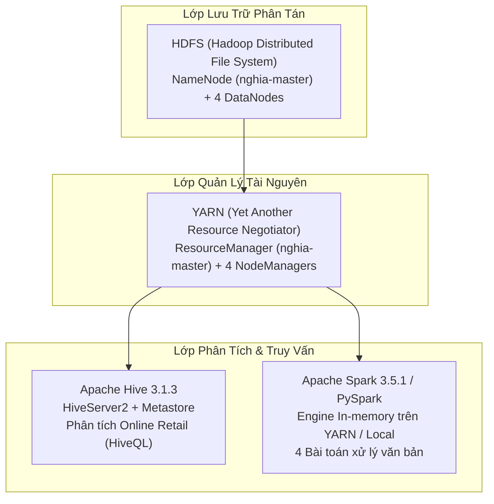

# TRIỂN KHAI HỆ SINH THÁI BIG DATA TRÊN HADOOP CLUSTER BẰNG DOCKER
## Big Data Ecosystem Deployment on Multi-Node Hadoop Cluster with Docker

<div align="center">

[](https://hcmute.edu.vn/)
[](#thông-tin-đồ-án)
[](#thành-viên-thực-hiện-nhóm-14)
[](#ngăn-xếp-công-nghệ)
[](#ngăn-xếp-công-nghệ)
[](#ngăn-xếp-công-nghệ)
[](#ngăn-xếp-công-nghệ)

</div>

---

## THÔNG TIN ĐỒ ÁN

- **Học phần:** Nhập môn Dữ liệu lớn (BigData) — Năm học 2025–2026
- **Đơn vị:** Khoa Công nghệ Thông tin — Trường Đại học Công nghệ Kỹ thuật TP. Hồ Chí Minh (HCMUTE)
- **Giảng viên hướng dẫn:** ThS. Lê Thị Minh Châu
- **Nhóm thực hiện:** Nhóm 14

---

## THÀNH VIÊN THỰC HIỆN (NHÓM 14)

| STT | Họ và Tên | MSSV | Vai Trò | Hostname / IP Node | Nhiệm Vụ Trọng Tâm | Mức Độ |
|:---:|:---|:---:|:---|:---|:---|:---:|
| 1 | **Huỳnh Trung Nghĩa** | `24133903` | **Master (Trưởng nhóm)** | `nghia-master`<br>`100.75.213.56` | Xây dựng Docker base image, cấu hình Hadoop, Hive, Spark/PySpark; điều phối cụm; kiểm thử tích hợp và tổng hợp báo cáo. | 100% |
| 2 | **Nguyễn Trung Khang** | `24133028` | **Worker 1** | `khang-worker`<br>`100.121.155.7` | Triển khai node Worker 1; thực thi HiveQL, thiết lập Data Warehouse, External Table trên HDFS và ghi nhận kết quả. | 100% |
| 3 | **Trần Anh Khoa** | `24133032` | **Worker 2** | `trankhoa-worker`<br>`100.111.178.15` | Triển khai node Worker 2; phân tích thuật toán, cài đặt và thực thi chương trình PySpark `WordMedian`. | 100% |
| 4 | **Hồng Đặng Anh Khoa** | `24133029` | **Worker 3** | `hongkhoa-worker`<br>`100.95.89.56` | Triển khai node Worker 3; phân tích thuật toán, cài đặt và thực thi chương trình PySpark `WordStandardDeviation`. | 100% |
| 5 | **Trần Duy Luân** | `24133036` | **Worker 4** | `luan-worker`<br>`100.76.101.124` | Triển khai node Worker 4; phân tích thuật toán, cài đặt và thực thi chương trình PySpark `WordCount` và `WordMean`. | 100% |

---

## MỤC LỤC

1. [Tổng Quan Đề Tài & Mục Tiêu Nghiên Cứu](#1-tổng-quan-đề-tài--mục-tiêu-nghiên-cứu)
2. [Kiến Trúc Hệ Thống & Ngăn Xếp Công Nghệ](#2-kiến-trúc-hệ-thống--ngăn-xếp-công-nghệ)
3. [Mô Hình Mạng & Danh Nhận Diện Node](#3-mô-hình-mạng--danh-nhận-diện-node)
4. [Cấu Trúc Thư Mục Dự Án](#4-cấu-trúc-thư-mục-dự-án)
5. [Quy Trình Triển Khai Cụm Phân Tán](#5-quy-trình-triển-khai-cụm-phân-tán)
6. [Kho Dữ Liệu Apache Hive & Phân Tích Doanh Thu](#6-kho-dữ-liệu-apache-hive--phân-tích-doanh-thu)
7. [Xử Lý Dữ Liệu Phân Tán Với Apache Spark / PySpark](#7-xử-lý-dữ-liệu-phân-tán-với-apache-spark--pyspark)
8. [Đánh Giá Thực Nghiệm, Khó Khăn & Giải Pháp](#8-đánh-giá-thực-nghiệm-khó-khăn--giải-pháp)
9. [Tài Liệu Tham Khảo](#9-tài-liệu-tham-khảo)

---

## 1. TỔNG QUAN ĐỀ TÀI & MỤC TIÊU NGHIÊN CỨU

### 1.1 Bối Cảnh & Đặt Vấn Đề
Trong kỷ nguyên dữ liệu số, sự bùng nổ thông tin từ các hệ thống giao dịch, bán lẻ trực tuyến và ứng dụng thông minh đặt ra thách thức lớn đối với kiến trúc máy chủ đơn lẻ (Single-node). Các hệ thống truyền thống nhanh chóng gặp giới hạn về năng lực tính toán CPU, bộ nhớ RAM và băng thông đọc ghi đĩa cứng. 

Mô hình tính toán phân tán (Distributed Computing) ra đời nhằm phân chia dữ liệu và khối lượng công việc thành nhiều phần nhỏ, xử lý song song trên một cụm máy tính (Cluster). Đề tài tập trung vào việc nghiên cứu và triển khai thực tế một hệ sinh thái Big Data hoàn chỉnh, kết hợp khả năng lưu trữ chịu lỗi của HDFS, năng lực điều phối tài nguyên của YARN, khả năng truy vấn kho dữ liệu của Apache Hive và tốc độ xử lý trong bộ nhớ (In-memory) của Apache Spark.

### 1.2 Mục Tiêu Đề Tài
- Xây dựng cụm phân tán đa nút gồm **1 Master và 4 Worker** trên hạ tầng máy tính cá nhân của 5 thành viên thông qua công nghệ ảo hóa Docker và mạng riêng ảo Tailscale.
- Khởi tạo hệ thống tệp phân tán Hadoop Distributed File System (HDFS) và thiết lập cơ chế quản lý tài nguyên tập trung YARN.
- Tích hợp kho dữ liệu Apache Hive (HiveServer2, Hive Metastore sử dụng Derby DB), ánh xạ bộ dữ liệu giao dịch thương mại bán lẻ (`online_retail.csv`) bằng External Table và thực thi các phân tích doanh thu qua HiveQL.
- Xây dựng 4 chương trình tính toán phân tán bằng PySpark trên tập dữ liệu văn bản (`description.txt`):
  - `WordCount`: Thống kê tần suất xuất hiện của từng từ.
  - `WordMean`: Tính giá trị trung bình độ dài từ.
  - `WordMedian`: Xác định giá trị trung vị độ dài từ.
  - `WordStandardDeviation`: Tính độ lệch chuẩn độ dài từ thông qua biến đổi đại số moment bậc hai.



---

## 2. KIẾN TRÚC HỆ THỐNG & NGĂN XẾP CÔNG NGHỆ

### 2.1 Ngăn Xếp Công Nghệ Khóa Phiên Bản
Nhằm bảo đảm tính tương thích tuyệt đối giữa các thành phần và loại bỏ hiện tượng lỗi phản chiếu JVM (Reflection Errors), toàn bộ hệ thống được chuẩn hóa trên môi trường:

- **Hệ điều hành Host:** Windows 10/11 64-bit tích hợp Docker Desktop (WSL 2 backend).
- **Hệ điều hành Container:** Ubuntu 24.04 LTS (`FROM ubuntu:24.04`).
- **Môi trường thực thi Java:** OpenJDK 8 (`openjdk-8-jdk`, `/usr/lib/jvm/java-8-openjdk-amd64`).
- **Hệ thống phân tán:** Apache Hadoop 3.4.0 (HDFS, YARN, MapReduce).
- **Kho dữ liệu phân tán:** Apache Hive 3.1.3 (xử lý xung đột `guava.jar` bằng cách thay thế thư viện tương thích từ Hadoop sang Hive).
- **Engine tính toán:** Apache Spark 3.5.1 kết hợp Python 3 (PySpark).
- **Quản lý mạng & Đóng gói:** Docker Engine, Docker Compose v2, OpenSSH Server/Client, Tailscale VPN.

### 2.2 Sơ Đồ Kiến Trúc Phân Bổ Tiến Trình

```text
                                  +-------------------------------------------------------+
                                  |                 MASTER (nghia-master)                 |
                                  |                   IP: 100.75.213.56                   |
                                  |-------------------------------------------------------|
                                  | - HDFS NameNode (Port 9870, 9000)                     |
                                  | - YARN ResourceManager (Port 8088, 8032)              |
                                  | - Hive Metastore (Port 9083) & HiveServer2 (Port 10000|
                                  | - Spark Driver / Client Submit                        |
                                  +-------------------------------------------------------+
                                                              |
                  +---------------------------+---------------+---------------------------+
                  |                           |                               |                           |
                  v                           v                               v                           v
+---------------------------+   +---------------------------+   +---------------------------+   +---------------------------+
|    WORKER 1 (khang-worker)|   |  WORKER 2 (trankhoa-worker|   |  WORKER 3 (hongkhoa-worker|   |   WORKER 4 (luan-worker)  |
|     IP: 100.121.155.7     |   |     IP: 100.111.178.15    |   |     IP: 100.95.89.56      |   |     IP: 100.76.101.124    |
|---------------------------|   |---------------------------|   |---------------------------|   |---------------------------|
| - HDFS DataNode (19866)   |   | - HDFS DataNode (19867)   |   | - HDFS DataNode (19868)   |   | - HDFS DataNode (19869)   |
| - YARN NodeManager (8042) |   | - YARN NodeManager (8042) |   | - YARN NodeManager (8042) |   | - YARN NodeManager (8042) |
| - Spark Executor          |   | - Spark Executor          |   | - Spark Executor          |   | - Spark Executor          |
+---------------------------+   +---------------------------+   +---------------------------+   +---------------------------+
```

---

## 3. MÔ HÌNH MẠNG & DANH NHẬN DIỆN NODE

### 3.1 Bảng Cấu Hình Mạng & Phân Định Cổng Giao Tiếp
Để tránh xung đột địa chỉ và bảo đảm tính định tuyến giữa các máy thành viên qua Tailscale, hệ thống phân định rõ ràng giữa Hostname vật lý, Bí danh logic (Logical Alias) và Cổng truyền dữ liệu (DataNode Transfer Port):

| Vai Trò | Thành Viên | Hostname Thực Tế | Bí Danh Logic | Địa Chỉ IP Tailscale | Cổng Dịch Vụ Chính | Cổng DataNode Xfer |
|:---|:---|:---|:---|:---|:---|:---:|
| **Master** | Huỳnh Trung Nghĩa | `nghia-master` | `master` | `100.75.213.56` | 9870, 9000, 8088, 8032, 10000, 7078 | — |
| **Worker 1** | Nguyễn Trung Khang | `khang-worker` | `worker1` | `100.121.155.7` | 8042, 9864, 7079 | **19866** |
| **Worker 2** | Trần Anh Khoa | `trankhoa-worker` | `worker2` | `100.111.178.15` | 8042, 9864, 7079 | **19867** |
| **Worker 3** | Hồng Đặng Anh Khoa | `hongkhoa-worker` | `worker3` | `100.95.89.56` | 8042, 9864, 7079 | **19868** |
| **Worker 4** | Trần Duy Luân | `luan-worker` | `worker4` | `100.76.101.124` | 8042, 9864, 7079 | **19869** |

### 3.2 Nguyên Tắc Phân Giải Danh Tính
- File `config/hadoop/workers` chỉ lưu các bí danh logic: `worker1`, `worker2`, `worker3`, `worker4`.
- Script `docker/entrypoint.sh` tự động nạp ánh xạ từ biến môi trường vào `/etc/hosts` của container khi khởi động, giúp các tiến trình Hadoop phân giải chuẩn xác giữa địa chỉ IP, hostname máy và bí danh cụm.
- Cơ chế kiểm soát kết nối đa tầng:
  - **Lớp 1 (Network connectivity):** Kiểm tra ping và định tuyến qua giao diện ảo Tailscale.
  - **Lớp 2 (Port accessibility):** Kiểm tra TCP handshake đến các cổng RPC (9000, 8032) và Data Transfer ports (19866–19869).
  - **Lớp 3 (Cluster registration):** Đối chiếu báo cáo đăng ký từ `hdfs dfsadmin -report` và `yarn node -list -all`.

---

## 4. CẤU TRÚC THƯ MỤC DỰ ÁN

```text
BigData-N14/
├── docker/
│   ├── Dockerfile                  # Base image đóng gói Java 8, Hadoop 3.4.0, Hive 3.1.3, Spark 3.5.1
│   ├── docker-compose.local.yml    # Cấu hình kiểm thử nội bộ trên 1 máy (Master + 1 Worker)
│   ├── docker-compose.master.yml   # Cấu hình vận hành Master phân tán trên máy trưởng nhóm
│   ├── docker-compose.worker.yml   # Cấu hình chuẩn vận hành Worker phân tán phát cho các thành viên
│   └── entrypoint.sh               # Kịch bản khởi tạo hệ thống, ánh xạ hosts và điều phối role
├── config/
│   ├── hadoop/
│   │   ├── core-site.xml           # Cấu hình fs.defaultFS, tmp.dir, Hadoop proxyuser
│   │   ├── hdfs-site.xml           # Cấu hình replication, thư mục block, endpoint NameNode
│   │   ├── yarn-site.xml           # Cấu hình ResourceManager, bộ nhớ cấp phát và tắt vmem-check
│   │   ├── mapred-site.xml         # Cấu hình MapReduce chạy trên YARN và đường dẫn classpath
│   │   └── workers                 # Danh sách bí danh logic của 4 worker node
│   ├── hive/
│   │   └── hive-site.xml           # Cấu hình Derby metastore, warehouse dir và cổng HiveServer2
│   └── spark/
│       └── spark-defaults.conf     # Cấu hình Spark chạy YARN client mode, driver/executor memory
├── pyspark/
│   ├── word_count.py               # Chương trình 1: Đếm tần suất từ (FlatMap, Map, ReduceByKey)
│   ├── word_mean.py                # Chương trình 2: Tính độ dài từ trung bình (Parallel Aggregate)
│   ├── word_median.py              # Chương trình 3: Xác định trung vị độ dài từ (Sort phân tán & ZipIndex)
│   └── word_std_dev.py             # Chương trình 4: Tính độ lệch chuẩn độ dài từ (Moment bậc hai)
├── hive/
│   ├── 01_create_warehouse.sql     # DDL tạo database bigdata_n14_db và External Table online_retail
│   └── 02_sales_analytics.sql      # HiveQL phân tích doanh thu theo Country, StockCode và Invoice
├── data/
│   ├── description.txt             # Dữ liệu văn bản mẫu phục vụ 4 chương trình PySpark
│   └── online_retail.csv           # Dữ liệu giao dịch thương mại bán lẻ mẫu phục vụ Hive Warehouse
├── scripts/
│   ├── build_image.sh              # Script tự động build Docker base image
│   ├── export_image.sh             # Script xuất image thành file nén .tar
│   ├── start_master.sh             # Script khởi động cụm Master đa nút
│   └── test_local.sh               # Script khởi động kiểm tra nhanh cụm nội bộ
├── .env.example                    # Tệp mẫu khai báo biến môi trường mạng
├── .gitignore                      # Danh mục loại trừ các tệp nhị phân lớn, log và biến môi trường
└── README.md                       # Hồ sơ kỹ thuật tổng quan và hướng dẫn vận hành dự án
```

---

## 5. QUY TRÌNH TRIỂN KHAI CỤM PHÂN TÁN

### 5.1 Khởi Tạo Môi Trường Mạng Tailscale
1. Tất cả 5 thành viên cài đặt Tailscale trên hệ điều hành Windows host.
2. Đăng nhập chung vào một mạng riêng ảo Tailnet của nhóm.
3. Thu thập địa chỉ IPv4 Tailscale (`100.x.y.z`) của từng thành viên và ghi nhận vào bảng phân công.

### 5.2 Các Bước Dành Cho Máy Master (nghia-master)
1. **Thiết lập biến môi trường:**
   ```powershell
   Copy-Item .env.example .env
   # Chỉnh sửa file .env với các IP Tailscale thực tế của 5 máy
   ```
2. **Build và đóng gói Docker Image:**
   ```bash
   bash scripts/build_image.sh
   bash scripts/export_image.sh
   # Sinh ra file: bigdata-cluster-1.0.tar (phân phối cho 4 thành viên)
   ```
3. **Khởi động cụm Master:**
   ```bash
   bash scripts/start_master.sh
   ```
4. **Kiểm tra trạng thái sẵn sàng của Master:**
   ```bash
   docker exec -it nghia-master jps
   # Yêu cầu xuất hiện: NameNode, ResourceManager, RunJar (Hive Metastore/Server)
   ```

### 5.3 Các Bước Dành Cho 4 Máy Worker
1. **Tiếp nhận và nạp Docker Image:**
   ```powershell
   Set-Location D:\BigData-N14
   docker load -i .\bigdata-cluster-1.0.tar
   ```
2. **Thiết lập file cấu hình `.env` cho từng máy:**
   Khai báo đầy đủ danh sách IP của cả nhóm và gán biến cục bộ tương ứng với slot:
   - **Máy 2 (Worker 1):** `NODE_HOSTNAME=khang-worker`, `WORKER_LOGICAL_NAME=worker1`, `WORKER_IP=100.121.155.7`, `WORKER_XFER_PORT=19866`
   - **Máy 3 (Worker 2):** `NODE_HOSTNAME=trankhoa-worker`, `WORKER_LOGICAL_NAME=worker2`, `WORKER_IP=100.111.178.15`, `WORKER_XFER_PORT=19867`
   - **Máy 4 (Worker 3):** `NODE_HOSTNAME=hongkhoa-worker`, `WORKER_LOGICAL_NAME=worker3`, `WORKER_IP=100.95.89.56`, `WORKER_XFER_PORT=19868`
   - **Máy 5 (Worker 4):** `NODE_HOSTNAME=luan-worker`, `WORKER_LOGICAL_NAME=worker4`, `WORKER_IP=100.76.101.124`, `WORKER_XFER_PORT=19869`
3. **Khởi động container Worker:**
   ```powershell
   docker compose --env-file .env -f .\docker\docker-compose.worker.yml up -d
   ```
4. **Kiểm tra tiến trình tại chỗ:**
   ```powershell
   docker exec -it <container_name> jps
   # Yêu cầu xuất hiện: DataNode, NodeManager
   ```

### 5.4 Nghiệm Thu Kết Nối Toàn Cụm (Thực Hiện Từ Master)
```bash
# Kiểm tra số lượng DataNode tham gia HDFS
docker exec -it nghia-master hdfs dfsadmin -report

# Kiểm tra số lượng NodeManager đã đăng ký với YARN
docker exec -it nghia-master yarn node -list -all
```
*Điều kiện đạt chuẩn:* HDFS ghi nhận `Live datanodes (4)` và YARN hiển thị `Total Nodes: 4` ở trạng thái `RUNNING`.

---

## 6. KHO DỮ LIỆU APACHE HIVE & PHÂN TÍCH DOANH THU

### 6.1 Chuẩn Bị Dữ Liệu Nguồn Trên HDFS
Dữ liệu giao dịch bán lẻ quốc tế được đẩy trực tiếp vào hệ thống tệp phân tán:
```bash
docker exec -it nghia-master hdfs dfs -mkdir -p /nhom14/input/hive_sales
docker exec -it nghia-master hdfs dfs -put /opt/data/online_retail.csv /nhom14/input/hive_sales/
```

### 6.2 Thiết Lập Data Warehouse & External Table
Thực thi script DDL thông qua Beeline client để khai báo bảng ngoài `online_retail` ánh xạ vào thư mục HDFS:
```bash
docker exec -it khang-worker /opt/hive/bin/beeline \
  -u "jdbc:hive2://nghia-master:10000/default" -n hadoopnghia \
  -f /opt/hive-scripts/01_create_warehouse.sql
```
- Sử dụng SerDe: `org.apache.hadoop.hive.serde2.OpenCSVSerde`.
- Bỏ qua dòng tiêu đề: `skip.header.line.count = 1`.
- Vị trí dữ liệu: `/nhom14/input/hive_sales`.

### 6.3 Phân Tích Dữ Liệu Bán Lẻ Bằng HiveQL
Thực thi script phân tích nghiệp vụ `02_sales_analytics.sql`:
```bash
docker exec -it khang-worker /opt/hive/bin/beeline \
  -u "jdbc:hive2://nghia-master:10000/bigdata_n14_db" -n hadoopnghia \
  -f /opt/hive-scripts/02_sales_analytics.sql
```

**Các câu hỏi phân tích trọng tâm:**
1. **Doanh thu theo quốc gia (Country Analytics):**
   ```sql
   SELECT country, COUNT(DISTINCT invoice) AS total_invoices,
          SUM(CAST(quantity AS BIGINT)) AS net_quantity,
          ROUND(SUM(CAST(quantity AS DOUBLE) * CAST(price AS DOUBLE)), 2) AS net_revenue
   FROM online_retail
   WHERE country IS NOT NULL AND TRIM(country) <> ''
   GROUP BY country ORDER BY net_revenue DESC LIMIT 10;
   ```
   *Kết quả thực nghiệm:* United Kingdom chiếm ưu thế tuyệt đối về quy mô doanh thu (>16.1 triệu đơn vị tiền tệ trên tổng số 48,509 hóa đơn), theo sau lần lượt là EIRE, Hà Lan (Netherlands) và Đức (Germany).

2. **Top sản phẩm có doanh thu cao nhất (Product Analytics):**
   ```sql
   SELECT stockcode, MAX(description) AS product_description,
          SUM(CAST(quantity AS BIGINT)) AS total_quantity,
          ROUND(SUM(CAST(quantity AS DOUBLE) * CAST(price AS DOUBLE)), 2) AS total_revenue
   FROM online_retail
   WHERE stockcode IS NOT NULL AND TRIM(stockcode) <> ''
   GROUP BY stockcode ORDER BY total_revenue DESC LIMIT 20;
   ```

3. **Tổng hợp giá trị hóa đơn (Invoice Analytics):**
   Xếp hạng các đơn hàng có giá trị giao dịch cao nhất nhằm phát hiện các giao dịch bán buôn hoặc hành vi mua sắm bất thường.

---

## 7. XỬ LÝ DỮ LIỆU PHÂN TÁN VỚI APACHE SPARK / PYSPARK

### 7.1 Chuẩn Bị Dữ Liệu Văn Bản Đầu Vào
```bash
docker exec -it nghia-master hdfs dfs -mkdir -p /nhom14/input/word
docker exec -it nghia-master hdfs dfs -put /opt/data/description.txt /nhom14/input/word/
```

### 7.2 Phương Pháp Luận & Thuật Toán 4 Bài Toán PySpark

#### 1. Bài toán WordCount (`word_count.py`)
- **Mục tiêu:** Thống kê tần suất xuất hiện của từng từ riêng biệt trong tập dữ liệu.
- **Quy trình tính toán:**
  - `FlatMap`: Đọc từng dòng văn bản, chuyển thành chữ thường (`lower()`), dùng biểu thức chính quy `re.split(r'\W+', line)` để tách từ và loại bỏ từ rỗng.
  - `Map`: Chuyển đổi mỗi từ hợp lệ thành cặp Key-Value `(word, 1)`.
  - `ReduceByKey`: Gom cụm theo từ và thực hiện cộng dồn tần suất song song trên các partition trước khi truyền dữ liệu qua mạng.
  - `SortBy`: Sắp xếp giảm dần theo số lần xuất hiện và in kết quả.

#### 2. Bài toán WordMean (`word_mean.py`)
- **Mục tiêu:** Tính giá trị trung bình độ dài từ trong văn bản theo công thức:
  $$\text{Mean} = \frac{\sum_{i=1}^{N} L_i}{N}$$
  *(Trong đó $L_i$ là độ dài của từ thứ $i$, $N$ là tổng số từ).*
- **Quy trình tính toán:** Tránh việc tính trung bình cục bộ trên từng phân vùng gây sai lệch toán học. Sử dụng hàm `aggregate((0, 0), seqOp, combOp)` để cộng dồn song song hai biến tích lũy: Tổng độ dài ký tự và Tổng số lượng từ trên toàn bộ RDD. Phép chia trung bình chỉ thực hiện một lần duy nhất tại Driver.

#### 3. Bài toán WordMedian (`word_median.py`)
- **Mục tiêu:** Xác định giá trị trung vị độ dài các từ (vị trí trung tâm của dãy phân phối đã sắp xếp).
- **Quy trình tính toán:**
  - Ánh xạ mỗi từ thành giá trị độ dài kiểu số nguyên.
  - Đếm tổng số từ $N$.
  - Sắp xếp phân tán RDD độ dài theo thứ tự tăng dần bằng `sortBy(lambda x: x)` và gán nhãn chỉ số qua `zipWithIndex()`.
  - Nếu $N$ lẻ: Lấy giá trị tại vị trí $k = \lfloor N/2 \rfloor$.
  - Nếu $N$ chẵn: Lấy hai giá trị tại vị trí $k_1 = N/2 - 1$ và $k_2 = N/2$, tính trung bình cộng:
    $$\text{Median} = \frac{L_{(k_1)} + L_{(k_2)}}{2}$$
  - Chỉ kéo (collect) đúng 1 hoặc 2 giá trị trung tâm về Driver, tối ưu hóa bộ nhớ hệ thống.

#### 4. Bài toán WordStandardDeviation (`word_std_dev.py`)
- **Mục tiêu:** Đo lường mức độ phân tán của độ dài từ so với giá trị trung bình.
- **Biến đổi đại số tối ưu:** Thay vì duyệt dữ liệu hai lần, áp dụng công thức moment bậc hai để tính toán trong một lần quét (Single-pass):
  $$\mu = \frac{S}{N}, \quad \sigma^2 = \frac{Q}{N} - \mu^2, \quad \sigma = \sqrt{\max(0, \sigma^2)}$$
  *(Với $S = \sum L_i$, $Q = \sum L_i^2$, $N$ là tổng số từ).*
- **Quy trình tính toán:** Ánh xạ mỗi từ thành bộ ba `(len, len^2, 1)`, dùng `aggregate` cộng dồn song song ba đại lượng trên cụm và hoàn tất phép tính căn bậc hai tại Driver.

### 7.3 Hướng Dẫn Thực Thi

**Thực thi trên cụm YARN Cluster qua Master:**
```bash
docker exec -it nghia-master /opt/spark/bin/spark-submit \
  --master yarn --deploy-mode client \
  /opt/pyspark/word_count.py hdfs:///nhom14/input/word/description.txt

docker exec -it nghia-master /opt/spark/bin/spark-submit \
  --master yarn --deploy-mode client \
  /opt/pyspark/word_mean.py hdfs:///nhom14/input/word/description.txt

docker exec -it nghia-master /opt/spark/bin/spark-submit \
  --master yarn --deploy-mode client \
  /opt/pyspark/word_median.py hdfs:///nhom14/input/word/description.txt

docker exec -it nghia-master /opt/spark/bin/spark-submit \
  --master yarn --deploy-mode client \
  /opt/pyspark/word_std_dev.py hdfs:///nhom14/input/word/description.txt
```

**Thực thi kiểm thử nhanh cục bộ (Local Mode) trên từng Worker:**
```bash
docker exec -it <worker_name> /opt/spark/bin/spark-submit \
  --master "local[*]" \
  /tmp/word_std_dev.py file:///opt/data/description.txt
```

---

## 8. ĐÁNH GIÁ THỰC NGHIỆM, KHÓ KHĂN & GIẢI PHÁP

### 8.1 Kết Quả Thực Nghiệm Thu Được
- **Về mặt hạ tầng:** Triển khai thành công 5 node container đồng nhất phiên bản. Cụm HDFS nhận diện đủ 4 DataNode, phân chia khối dữ liệu an toàn. YARN quản lý tập trung và phân bổ tài nguyên cho các ứng dụng.
- **Về kho dữ liệu Hive:** Nạp và truy vấn thành công 1,048,575 dòng dữ liệu Online Retail; các tác vụ lọc và tổng hợp đa chiều cho kết quả chính xác và tin cậy.
- **Về tính toán PySpark:** Cả 4 bài toán xử lý chuỗi trên tập dữ liệu mẫu (5,000 từ) đều cho kết quả chuẩn xác:
  - Tổng số từ hợp lệ: 5,000 từ.
  - Độ dài trung bình (Mean): **5.0640** ký tự/từ.
  - Độ dài trung vị (Median): **5.0000** ký tự/từ.
  - Phương sai (Variance): **3.9715** | Độ lệch chuẩn (Std Dev): **1.9929** ký tự/từ.

### 8.2 Khó Khăn Kỹ Thuật & Biện Pháp Khắc Phục

| STT | Vấn Đề Kỹ Thuật | Nguyên Nhân Cốt Lõi | Biện Pháp Khắc Phục Đã Áp Dụng |
|:---:|:---|:---|:---|
| 1 | Các DataNode thay phiên xuất hiện, HDFS chỉ ghi nhận 1 node Live duy nhất. | Các Worker khi dùng chung Docker compose mặc định báo cáo cùng địa chỉ IP nội bộ và trùng cổng DataNode transfer. | Tách riêng biến `WORKER_XFER_PORT` (19866–19869) và gán `WORKER_IP` cố định cho từng thành viên, bổ sung cờ `use.datanode.hostname=true`. |
| 2 | Hive 3.1.3 xung đột thư viện không thể khởi chạy trên nền Hadoop 3.4.0. | Bản phân phối Hive 3.1.3 chứa gói thư viện `guava-19.0.jar` quá cũ, xung đột với `guava-27.0-jre.jar` của Hadoop 3.4.0. | Viết lệnh trong `Dockerfile` tự động gỡ bỏ guava cũ của Hive và copy gói guava tương thích từ thư viện chung của Hadoop sang Hive `lib/`. |
| 3 | Container bị lỗi YARN killed do vượt ngưỡng bộ nhớ ảo trên môi trường ảo hóa. | WSL 2 và Docker trên Windows cấp phát bộ nhớ ảo khác biệt so với Linux thuần, khiến bộ kiểm tra vmem của YARN hiểu nhầm. | Thiết lập cấu hình `yarn.nodemanager.vmem-check-enabled=false` và `yarn.nodemanager.pmem-check-enabled=false` trong `yarn-site.xml`. |
| 4 | Lỗi phân quyền khi Hive và Spark gửi tác vụ lên HDFS và YARN. | Các tiến trình chạy dưới quyền user `hadoopnghia` nhưng các dịch vụ nền tảng mặc định đòi hỏi quyền ủy thác của proxyuser. | Khai báo toàn diện cấu hình proxyuser cho cả `hadoopnghia` và `root` trong `core-site.xml` (`hosts=*`, `groups=*`, `users=*`). |

---

## 9. TÀI LIỆU THAM KHẢO

1. Apache Software Foundation, *"Apache Hadoop Documentation (v3.4.0) — HDFS Architecture & YARN,"* 2024. [Trực tuyến]. Nguồn: https://hadoop.apache.org/docs/r3.4.0/
2. Apache Software Foundation, *"Apache Hive Documentation — LanguageManual DDL & HiveServer2,"* 2024. [Trực tuyến]. Nguồn: https://hive.apache.org/
3. Apache Software Foundation, *"Apache Spark Documentation (v3.5.1) — Cluster Mode Overview & PySpark Programming Guide,"* 2024. [Trực tuyến]. Nguồn: https://spark.apache.org/docs/3.5.1/
4. Docker Inc., *"Docker Compose Documentation — Networking in Compose & Environment Variables,"* 2024. [Trực tuyến]. Nguồn: https://docs.docker.com/compose/
5. Tailscale Inc., *"Tailscale Documentation — Mesh VPN Networking based on WireGuard,"* 2024. [Trực tuyến]. Nguồn: https://tailscale.com/kb/
6. T. White, *Hadoop: The Definitive Guide*, 4th ed., Sebastopol, CA: O'Reilly Media, 2015.
7. B. Chambers and M. Zaharia, *Spark: The Definitive Guide: Big Data Processing Made Simple*, Sebastopol, CA: O'Reilly Media, 2018.
